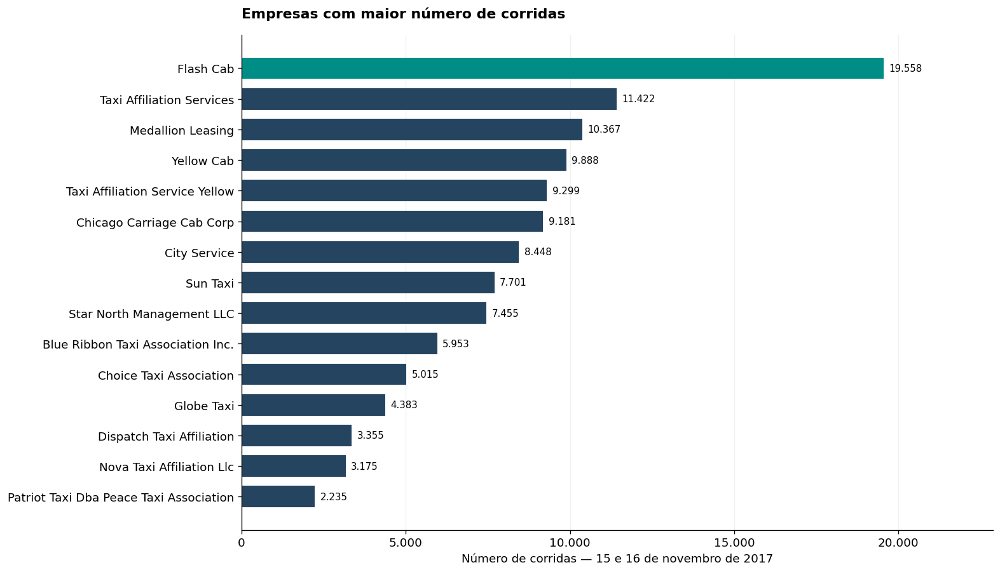
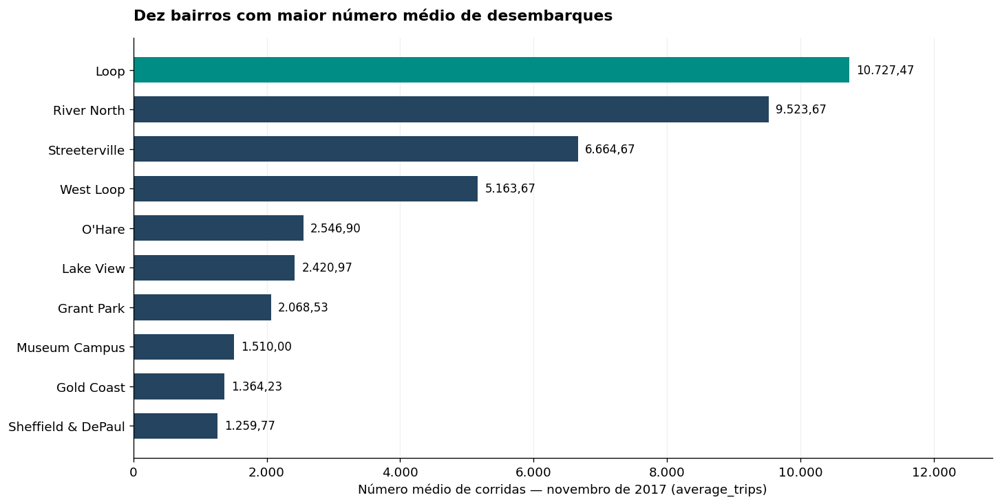
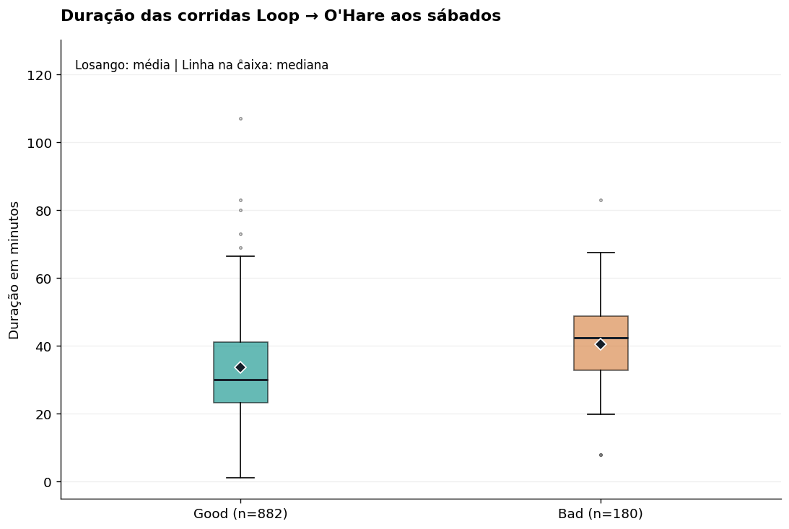

# Sprint 7 — Zuber: corridas de táxi em Chicago

Projeto de análise de dados desenvolvido no programa de Ciência de Dados da TripleTen. A Zuber está se preparando para operar em Chicago; o objetivo deste estudo é entender a distribuição de corridas entre empresas e destinos e avaliar a diferença de duração entre corridas do Loop para O’Hare em sábados com condições meteorológicas classificadas como `Bad` ou `Good`.

> **Escopo:** os dados são de novembro de 2017. A análise meteorológica testa a duração média das corridas aos sábados, conforme o enunciado. Ela não testa diretamente o efeito do clima sobre a frequência total de viagens.

## Arquivos

- [`Projeto_Zuber.ipynb`](Projeto_Zuber.ipynb) — notebook completo, com coleta do clima, consultas SQL documentadas, exploração, gráficos, teste de hipótese e verificações de sensibilidade.
- [`Consultas_Zuber.sql`](Consultas_Zuber.sql) — consultas PostgreSQL dos passos 2 e 3.
- [`Relatorio_Zuber.html`](reports/Relatorio_Zuber.html) — relatório HTML exportado do notebook.
- `data/` — três arquivos CSV agregados/consultados fornecidos pelo projeto.
- `resultados/` — gráficos exportados para visualização neste README.
- [`requirements.txt`](requirements.txt) — bibliotecas Python necessárias.

## Principais resultados

### Empresas de táxi

No recorte de 15 e 16 de novembro, Flash Cab lidera com **19.558 corridas**. Taxi Affiliation Services aparece em segundo, com **11.422**. As dez maiores empresas somam aproximadamente **72,3%** das corridas observadas. É um retrato de dois dias, portanto não deve ser interpretado como participação de mercado de todo o mês.



### Bairros de destino

Loop lidera a média de desembarques em novembro, seguido por River North, Streeterville e West Loop. O’Hare aparece em **5º lugar**, com média de aproximadamente **2.546,9** corridas. A presença de áreas centrais e de atividade comercial entre os principais destinos pode ajudar a orientar estudos de cobertura; os dados, por si só, não explicam os motivos de cada viagem.



### Duração e clima

As corridas `Bad` — descrições contendo “rain” ou “storm” — tiveram duração média de **40,45 minutos**, contra **33,55 minutos** no grupo `Good`. O teste t bilateral de Welch, com **α = 0,05**, encontrou diferença entre as médias (p ≈ **2,42 × 10⁻¹¹**), mantendo as durações positivas e todas as linhas originais.

A decisão estatística também se mantém numa análise de sensibilidade sem linhas exatamente repetidas (p ≈ **2,86 × 10⁻⁷**). O CSV não inclui `trip_id`, e o horário é arredondado; por isso, linhas iguais podem representar corridas distintas. A comparação sem repetições é uma verificação de sensibilidade, não uma confirmação de duplicidade real.



O resultado por corrida depende da unidade de análise: uma comparação exploratória das médias por hora não rejeitou a igualdade ao nível de 5%. Há somente quatro sábados na amostra, e as corridas de uma mesma hora podem compartilhar clima e condições de trânsito. A conclusão é associativa e limitada a essa rota e a esses sábados; não prova que a chuva cause o aumento da duração.

## Métodos e ferramentas

- **SQL / PostgreSQL:** agregações por empresa e período, agrupamento de empresas menores em `Other`, classificação horária do clima com `CASE` e associação das corridas aos registros meteorológicos pelo horário.
- **Python:** pandas e NumPy para preparação e validação; Matplotlib para visualização; SciPy para o teste t de Welch.
- **Coleta:** extração da tabela meteorológica da página indicada no enunciado.

## Estrutura do projeto

```text
sprint-07-zuber/
├── README.md
├── Projeto_Zuber.ipynb
├── Consultas_Zuber.sql
├── requirements.txt
├── data/
│   ├── project_sql_result_01.csv
│   ├── project_sql_result_04.csv
│   └── project_sql_result_07.csv
├── resultados/
│   ├── empresas_top15.png
│   ├── bairros_top10.png
│   └── duracao_por_clima.png
└── reports/
    └── Relatorio_Zuber.html
```

## Como executar

1. Crie um ambiente Python e instale as dependências:

   ```bash
   pip install -r requirements.txt
   ```

2. Abra `Projeto_Zuber.ipynb` no Jupyter Notebook ou JupyterLab e execute as células em ordem.
3. As consultas do arquivo `Consultas_Zuber.sql` devem ser executadas no banco PostgreSQL do curso. Os CSVs incluídos permitem executar as etapas de análise em Python.

O notebook busca os CSVs primeiro em `data/`, depois em `/datasets/` e, por último, na pasta atual. Caso a tabela meteorológica não esteja local, o notebook tenta obtê-la da fonte pública indicada no próprio notebook.
